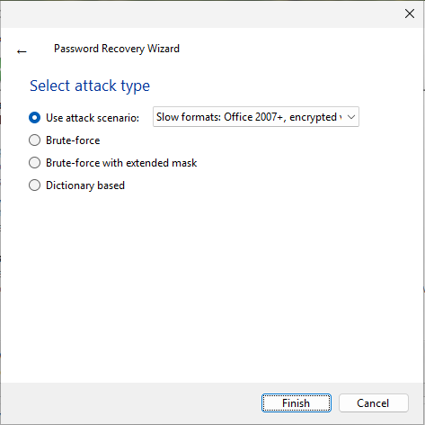
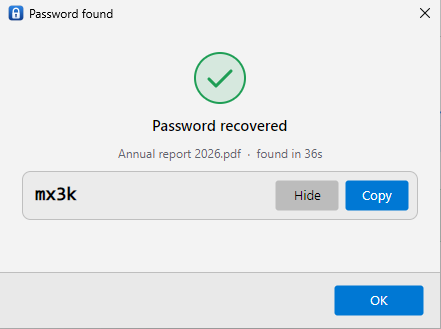
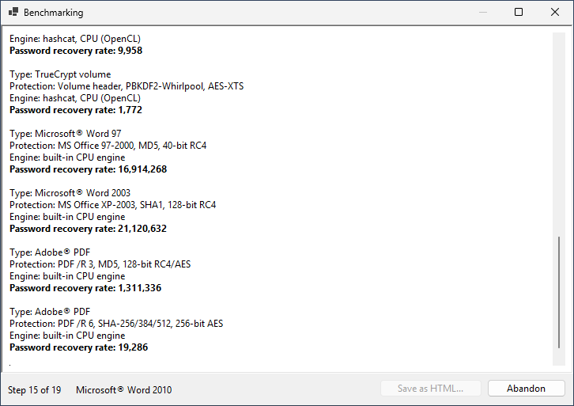

  

<h1 align="center">RecoverKit</h1>

  <b>Forgot the password to your own document, archive or backup? RecoverKit helps you get back in.</b> 
  Free, open source, for Windows 10 and 11 (64-bit) and Macs with Apple silicon.

  <a href="https://github.com/007hacky007/RecoverKit/releases/latest"><b>Download the latest version</b></a>
  &nbsp;·&nbsp;
  <a href="#what-it-can-open">What it can open</a>
  &nbsp;·&nbsp;
  <a href="#how-fast-is-it">How fast is it?</a>
  &nbsp;·&nbsp;
  <a href="#getting-started">Getting started</a>
  &nbsp;·&nbsp;
  <a href="CHANGELOG.md">What's new</a>

  

> [!IMPORTANT]
> Use RecoverKit only on files that belong to you or that you have permission to open.

## What it does

For files that are properly encrypted, RecoverKit does not "remove" a password. It finds the
password by trying possible passwords, very quickly. You tell it what you remember about the password (for example "about 6
characters, lower case letters and digits" or "one of the words in this list, maybe with a
number at the end"), and it tests those combinations until it finds the right one.

- **Short or simple passwords** are usually found in seconds or minutes.
- **Long, random passwords** can take far longer than anyone can wait. The program shows an
  estimated time before you start, so you know what to expect.
- **A graphics card (GPU) helps a lot.** NVIDIA, AMD and Intel Arc cards are supported and can be
  tens of times faster than the processor. On a Mac the Apple silicon GPU is used. Without a graphics
  card RecoverKit uses the processor, with its own fast engine for the most common formats (on Apple
  silicon it uses the chip's NEON and crypto instructions).

## What it can open

| Kind of file | Examples |
|---|---|
| Microsoft Office documents | Word, Excel and PowerPoint, from Office 6/95 up to Microsoft 365 |
| PDF documents | All standard PDF passwords, from old Acrobat files to current AES-256 ones |
| Archives | ZIP (classic and WinZip AES), RAR 3 and RAR 5, 7-Zip (.7z) |
| OpenDocument files | LibreOffice and OpenOffice documents |
| Password managers | KeePass 1 (.kdb) and KeePass 2 / KeePassXC (.kdbx) databases, with an optional keyfile |
| Cryptocurrency wallets | Ethereum keystore files, Electrum, MetaMask vaults, Blockchain.com wallet backups |
| Encrypted disks | TrueCrypt and VeraCrypt volumes |
| Phone backups | Encrypted iPhone / iPad backups (iTunes or Finder) and Android backups (.ab) |
| Wi-Fi | WPA/WPA2 handshakes from your own network |

### Opened instantly, no search needed

Some protections are weak enough that RecoverKit undoes them right away. It shows the password or
saves a copy without the protection; the original file is never changed.

- **Old Word and Excel files:** passwords of Word 6/95, Excel 5/95 and Office 97-2003 files saved
  with "XOR" protection.
- **Excel files that open in Excel without a password:** Excel's built-in default password
  ("VelvetSweatshop") and empty passwords.
- **Editing restrictions:** Excel sheet and workbook protection, Word "read-only", "comments only",
  "filling in forms" and "password to modify", and OpenDocument protected sections.
- **PDF permissions:** printing and copying restrictions on PDFs that open without a password.
- **Access databases:** passwords of Access 97-2003 databases (.mdb).
- **Some older ZIP archives, within minutes:** archives made by WinZip 8 or older, or by the
  Windows `zip.exe` that many scripts and tools still use, with five or more encrypted files.
  A known weakness (Stay's attack, 2001) lets RecoverKit recover the archive's keys whatever the
  password; it saves a copy without a password and keeps looking for the password itself. This
  can be turned off in Preferences > Key search.

Just open the file (or drag it onto the window). RecoverKit recognizes the format by itself.

## Features

<table>
  <tr>
    <td width="50%" valign="top">
       
      <b>Step-by-step wizard.</b> Pick a ready-made plan, or choose how to search yourself:
      every combination of characters, a pattern you remember, or a list of words. Each choice
      shows how long it can take on your computer.
    </td>
    <td width="50%" valign="top">
       
      <b>Tell it what you remember.</b> Which characters, how long, and parts you already know.
      It shows how many passwords that is and how long it will take.
    </td>
  </tr>
  <tr>
    <td width="50%" valign="top">
       
      <b>Found it.</b> The password is shown and copied to the clipboard. For Word, Excel and
      PowerPoint 2007 and newer, RecoverKit can also save an unlocked copy.
    </td>
    <td width="50%" valign="top">
       
      <b>Benchmark.</b> Measures how fast your computer is for every format and saves a report
      you can compare with other computers.
    </td>
  </tr>
</table>

More things it does:

- **Pause and continue later.** Stop an attack and pick it up where it left off, even after a
  restart. Passwords it has already found are remembered.
- **Smart word lists.** Built-in English word lists, your own lists, and variations such as
  `Password1`, `PASSWORD` or `drowssap`. A rules editor shows a preview of the variations.
- **Ready-made plans** that run several methods in a row, from quick guesses to longer searches.
- **Works with any language.** Passwords with accents and non-Latin letters are supported.
- **Unlocks very old Office and PDF files for certain.** Files from Office 97-2003 and early PDF
  versions use weak 40-bit encryption, so RecoverKit can search every possible key and always
  succeed (fast with a graphics card). Some later PDFs with 40-bit encryption only support a
  password search.
- **Extra tools:** create your own word lists from any search, and prepare Wi-Fi lookup tables.
- **Check for updates** from the Help menu (only when you click it).

## How fast is it?

Measured on the same office PC (Intel Xeon processor, no graphics card), RecoverKit against a
well-known commercial password-recovery program, both using only the processor:

  

RecoverKit is faster for nearly every format, and almost four times as fast on current PDF files.
For TrueCrypt volumes protected with Whirlpool and a single cipher, the built-in CPU engine
tests about **4,000 passwords per second**, 1.44 times the commercial benchmark.

What do the numbers mean in practice? For a current PDF, RecoverKit tests about **19,000
passwords per second** on that PC. Every possible 5-character password made of lower case letters
and digits (60 million of them) takes under an hour. Older formats are much faster: Word 97 files
are tested at **17 million passwords per second**, so the same search takes 4 seconds.

All measurements, and how they were made: [docs/benchmarks.md](docs/benchmarks.md).

### Detailed performance report

If the developers ask for a detailed performance report: **Tools > Benchmark > Detailed
performance test**, then **Save report** and send the file. Select which sections to run;
the default has a two-minute total budget, including engine startup. Unfinished measurements are
listed as "not measured, run the thorough test".
**Thorough (slower)** runs the full sweep for developers. The test uses synthetic targets and keeps completed results if
you abandon it. The HTML report includes the measurements and a **Copy summary** button.

The measurements also build a performance profile for this PC. RecoverKit keeps the current
method unless a correctness-checked alternative wins by at least 5% in repeated measurements.
On a PC without measurements, a longer attack can run a short automatic calibration first.
**Preferences > Performance** shows the profile, with **Reset**, **Run detailed test**, and
**Measure the fastest method automatically**. Your explicit settings take priority.

The automatic check measures CPU paths and worker counts. Run the detailed test to compare GPU
backends and finite CPU/GPU/hybrid jobs. Whole-job engine comparisons currently cover RAR 5 and
classic stored ZIP. Other formats keep their existing engine strategy. Temperature and power
limits are respected; some GPU comparisons are skipped when those limits cannot be enforced.

## Getting started

1. **Download** from the [Releases page](https://github.com/007hacky007/RecoverKit/releases/latest):
   - Windows: `RecoverKit-x.y.z-x64.msi` is the **installer** (recommended). Double-click it and follow the steps.
   - Windows: `RecoverKit-x.y.z-x64-portable.zip` is the **portable version**. Unzip it anywhere (even a USB
     stick) and run `RecoverKit.exe`. Nothing is installed.
   - Mac (Apple silicon, macOS 15 or later): `RecoverKit-x.y.z-macos-arm64.dmg`. Open it and drag
     RecoverKit to Applications. The disk image shows how to open it the first time (see below).
2. **First start:** on Windows, RecoverKit offers to download the free recovery engine
   ([hashcat](https://hashcat.net)). If your computer has no graphics card, it also offers Intel's free
   processor driver. Both come from their official sources, are checked, and are stored in your user
   folder only. The Mac version already contains hashcat and sets it up by itself.
3. **Open the protected file** (File > Open, or drag it onto the window) and follow the wizard.

Not sure which method to choose? Keep the suggested plan and click **Finish**. It starts with the
quickest guesses.

> [!TIP]
> On Windows, start RecoverKit normally, not with "Run as administrator". When it runs as administrator,
> Windows does not let it use the processor driver.

## Good to know

- Windows may show a SmartScreen warning the first time, because the program is not signed by a
  paid certificate. Click **More info > Run anyway**.
- On a Mac the first start shows "RecoverKit Not Opened", because the app is not notarized by Apple.
  Click **Done**, then open **System Settings > Privacy & Security**, scroll down and click **Open
  Anyway**. This is needed only once. The first start can take a minute while macOS checks the app.
- Your files never leave your computer. RecoverKit only connects to the internet to download the
  engine (Windows) and when you click Check for updates.
- If something goes wrong, Help > Open debug log folder has a log you can attach to a bug report.
  Recovered passwords are never written to it.
- **TrueCrypt and VeraCrypt:** File > Open As lets you add keyfiles. For VeraCrypt, enter the
  known PIM or leave it at 0 for the default. All selected keyfiles are required; system encryption
  does not support keyfiles.
- **KeePass:** when you open a database, RecoverKit asks whether it also needs a keyfile, and the
  keyfile must be available. Databases from KeePass 2 and KeePassXC that use Argon2 are built to be
  slow to crack, so only short or guessable passwords are realistic. KDBX 4 databases that use
  ChaCha20 or the older AES-KDF cannot be recovered yet (a hashcat limitation).
- **RAR 3 with visible file names:** RecoverKit recovers the password of one encrypted
  file (it picks the most reliable one). Other files in the same archive may use a different
  password. Split (multi-volume) archives and files that need earlier files of a solid archive
  cannot be used.
- **7-Zip:** archives with encrypted or visible file names, solid or not, and self-extracting .exe
  archives work. Split archives (.7z.001, .7z.002, ...) must be joined into one file first. 7-Zip's
  encryption is deliberately slow, so only short or guessable passwords are realistic.
- **GPU temperature and load:** Preferences > GPU can pause the attack while the GPU is too hot (it resumes once the GPU has
  cooled by the amount you choose) and can let the GPU work only part of the time to cut heat and
  noise. Both are off by default. Paused attacks continue exactly where they stopped.
- **NVIDIA power limit:** with an NVIDIA GPU on Windows or Linux you can also set a real power limit in watts. Only an
  administrator may change it, so at the start of each attack RecoverKit explains this and then the
  system asks for permission. A small helper changes only the power limit and puts the previous
  value back when the attack ends (also if RecoverKit crashes); RecoverKit itself never runs as
  administrator. If you decline, the attack runs without the limit. Not available on Macs and for
  AMD or Intel GPUs.
- **Crypto wallets:** you need the wallet file from your own device; an address or public key is
  not enough. For MetaMask, choose the vault text or the browser's extension storage file
  (`.ldb` or `.log`); if it holds several vaults, the first complete one is used. Blockchain.com:
  the main password only, not the second password. Exodus wallets are recognized but not
  supported yet. Always confirm a found password in the wallet itself.
- **Word editing restrictions:** "read-only", "comments only", "filling in forms" and "password to
  modify" can be removed from .docx, .doc and .odt files that open without a password. RecoverKit
  saves a separate copy and never changes the original.
- **Android backups:** RecoverKit finds the backup password; it does not unpack the backup.
- **Excel sheet and workbook protection:** RecoverKit saves a copy without the protection and
  also shows a password that Excel accepts for old-style protection. Files that need a password to
  open must be recovered first. VBA project passwords and .xlsb files are not supported yet.
- **Old Word and Excel files (Word 6/95, Excel 5/95, and 97-2003 files saved with "XOR"
  protection):** the password is shown instantly in most cases. If the file holds too little data
  to be sure, RecoverKit says so instead of guessing.
- **Excel files that open in Excel without a password:** Excel sometimes encrypts a workbook with
  its built-in default password "VelvetSweatshop", which other programs then ask for. RecoverKit
  recognizes this (and empty passwords) instantly and can save a normal copy of .xlsx files; for
  old .xls files it shows the password.
- **CPU and GPU together:** brute-force and mask attacks on ZIP, Office 97-2003, PDF, RAR 3 and
  TrueCrypt (Whirlpool) use all your GPUs and the processor at the same time, each on its own part
  of the passwords. Preferences > Performance can turn this off.
- Not supported yet: LibreOffice files using the newest Argon2 encryption.

## For developers

Building from source, the command-line tool and the scenario file format are described in
[docs/DEVELOPERS.md](docs/DEVELOPERS.md).

Classic ZIP archives with large encrypted files use a prefix on the GPU and check each hit against
the whole file. Large uncompressed entries use the CPU because their short GPU check can hide the
real password among wrong matches. Without RecoverKit's ZIP GPU kernels, large entries also use
the CPU; this fallback supports brute-force, masks and plain dictionaries, without hashcat rules
or extra options. Enable the built-in CPU engine in Preferences for these attacks.
Stopping waits for the current whole-file password check to finish; for very large files this can
take longer than a normal status update.

The native ZipCrypto CPU paths are measured on Apple silicon (ARM CRC and NEON). Native AVX2
and AVX-512 are experimental, compiled but unexecuted here; x86 keeps managed search by default.
`bench-native` includes a native comparison row for remote measurements. See the
[CPU results and path selectors](docs/benchmarks.md#native-zipcrypto-cpu-follow-up-apple-m1-pro).

## License

RecoverKit is free software under the MIT License (see [LICENSE](LICENSE)). Components it downloads
when needed are listed in [NOTICE](NOTICE). Product names such as Microsoft Word, Adobe PDF, WinZip,
RAR, TrueCrypt and VeraCrypt are trademarks of their respective owners and are used only to describe
which files RecoverKit can open.
