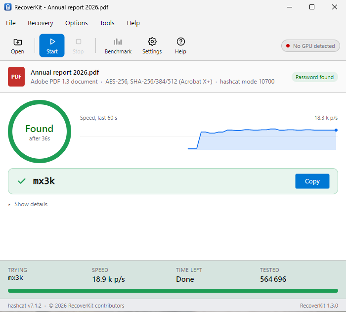
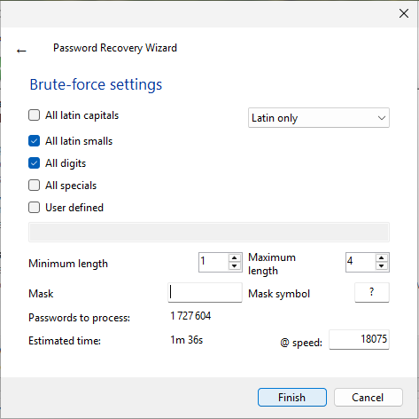
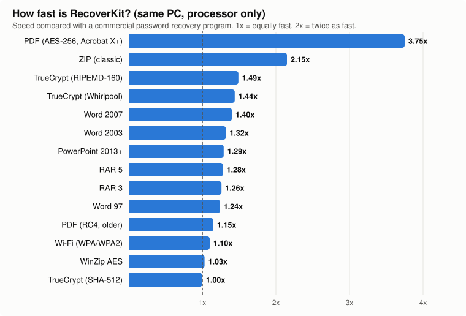

  

<h1 align="center">RecoverKit</h1>

  <b>Forgot the password to your own document, archive or backup? RecoverKit helps you get back in.</b> 
  Free, open source, for Windows 10 and 11 (64-bit) and Macs with Apple silicon.

  <a href="https://github.com/007hacky007/RecoverKit/releases/latest"><b>Download the latest version</b></a>
  &nbsp;·&nbsp;
  <a href="#what-it-can-open">What it can open</a>
  &nbsp;·&nbsp;
  <a href="#how-fast-is-it">How fast is it?</a>
  &nbsp;·&nbsp;
  <a href="#getting-started">Getting started</a>
  &nbsp;·&nbsp;
  <a href="CHANGELOG.md">What's new</a>

  

> [!IMPORTANT]
> Use RecoverKit only on files that belong to you or that you have permission to open.

## What it does

RecoverKit does not "remove" a password. It finds the password by trying possible passwords,
very quickly. You tell it what you remember about the password (for example "about 6
characters, lower case letters and digits" or "one of the words in this list, maybe with a
number at the end"), and it tests those combinations until it finds the right one.

- **Short or simple passwords** are usually found in seconds or minutes.
- **Long, random passwords** can take far longer than anyone can wait. The program shows an
  estimated time before you start, so you know what to expect.
- **A graphics card (GPU) helps a lot.** NVIDIA, AMD and Intel Arc cards are supported and can be
  tens of times faster than the processor. On a Mac the Apple silicon GPU is used. Without a graphics
  card RecoverKit uses the processor, with its own fast engine for the most common formats (on Apple
  silicon it uses the chip's NEON and crypto instructions).

## What it can open

| Kind of file | Examples |
|---|---|
| Microsoft Office documents | Word, Excel and PowerPoint, from Office 97 up to Microsoft 365 |
| PDF documents | All standard PDF passwords, from old Acrobat files to current AES-256 ones |
| Archives | ZIP (classic and WinZip AES), RAR 3 and RAR 5, 7-Zip (.7z) |
| OpenDocument files | LibreOffice and OpenOffice documents |
| Encrypted disks | TrueCrypt and VeraCrypt volumes |
| Phone backups | Encrypted Apple iPhone / iPad backups made with iTunes or Finder |
| Wi-Fi | WPA/WPA2 handshakes from your own network |
| KeePass databases | KeePass 1 KDB (AES/Twofish), KDBX 2/3 (AES), KDBX 4 (Argon2d/Argon2id, 253-byte headers) |
| Cryptocurrency wallets | Ethereum keystore v3, Electrum, MetaMask vaults, Blockchain.com backups |

Classic ZIP archives made by WinZip 8 and older (and other Info-ZIP-based zippers on Windows)
with five or more encrypted files are opened in minutes without any password guessing: RecoverKit
recovers the archive's internal cipher keys from the weak, rand()-seeded encryption headers
(Stay's attack, FSE 2001), writes a password-free decrypted copy, and then still tries the
normal password attacks. The step runs automatically for compatible archives and can be turned
off in Preferences > Key search.

Just open the file (or drag it onto the window). RecoverKit recognizes the format by itself.

## Features

<table>
  <tr>
    <td width="50%" valign="top">
       
      <b>Step-by-step wizard.</b> Pick a ready-made plan, or choose how to search yourself:
      every combination of characters, a pattern you remember, or a list of words. Each choice
      shows how long it can take on your computer.
    </td>
    <td width="50%" valign="top">
       
      <b>Tell it what you remember.</b> Which characters, how long, and parts you already know.
      It shows how many passwords that is and how long it will take.
    </td>
  </tr>
  <tr>
    <td width="50%" valign="top">
       
      <b>Found it.</b> The password is shown and copied to the clipboard. For Word, Excel and
      PowerPoint 2007 and newer, RecoverKit can also save an unlocked copy.
    </td>
    <td width="50%" valign="top">
       
      <b>Benchmark.</b> Measures how fast your computer is for every format and saves a report
      you can compare with other computers.
    </td>
  </tr>
</table>

More things it does:

- **Pause and continue later.** Stop an attack and pick it up where it left off, even after a
  restart. Passwords it has already found are remembered.
- **Smart word lists.** Built-in English word lists, your own lists, and variations such as
  `Password1`, `PASSWORD` or `drowssap`. A rules editor shows a preview of the variations.
- **Ready-made plans** that run several methods in a row, from quick guesses to longer searches.
- **Works with any language.** Passwords with accents and non-Latin letters are supported.
- **Unlocks very old Office and PDF files for certain.** Files from Office 97-2003 and early PDF
  versions use weak 40-bit encryption, so RecoverKit can search every possible key and always
  succeed (fast with a graphics card).
- **Extra tools:** create your own word lists from any search, and prepare Wi-Fi lookup tables.
- **Check for updates** from the Help menu (only when you click it).

## How fast is it?

Measured on the same office PC (Intel Xeon processor, no graphics card), RecoverKit against a
well-known commercial password-recovery program, both using only the processor:

  

RecoverKit is faster for nearly every format, and almost four times as fast on current PDF files.
For TrueCrypt volumes protected with Whirlpool and a single cipher, the built-in CPU engine
tests about **4,000 passwords per second**, 1.44 times the commercial benchmark.

What do the numbers mean in practice? For a current PDF, RecoverKit tests about **19,000
passwords per second** on that PC. Every possible 5-character password made of lower case letters
and digits (60 million of them) takes under an hour. Older formats are much faster: Word 97 files
are tested at **17 million passwords per second**, so the same search takes 4 seconds.

All measurements, and how they were made: [docs/benchmarks.md](docs/benchmarks.md).

## Getting started

1. **Download** from the [Releases page](https://github.com/007hacky007/RecoverKit/releases/latest):
   - Windows: `RecoverKit-x.y.z-x64.msi` is the **installer** (recommended). Double-click it and follow the steps.
   - Windows: `RecoverKit-x.y.z-x64-portable.zip` is the **portable version**. Unzip it anywhere (even a USB
     stick) and run `RecoverKit.exe`. Nothing is installed.
   - Mac (Apple silicon, macOS 15 or later): `RecoverKit-x.y.z-macos-arm64.dmg`. Open it and drag
     RecoverKit to Applications. The disk image shows how to open it the first time (see below).
2. **First start:** on Windows, RecoverKit offers to download the free recovery engine
   ([hashcat](https://hashcat.net)). If your computer has no graphics card, it also offers Intel's free
   processor driver. Both come from their official sources, are checked, and are stored in your user
   folder only. The Mac version already contains hashcat and sets it up by itself.
3. **Open the protected file** (File > Open, or drag it onto the window) and follow the wizard.

Not sure which method to choose? Keep the suggested plan and click **Finish**. It starts with the
quickest guesses.

> [!TIP]
> On Windows, start RecoverKit normally, not with "Run as administrator". When it runs as administrator,
> Windows does not let it use the processor driver.

## Good to know

- Windows may show a SmartScreen warning the first time, because the program is not signed by a
  paid certificate. Click **More info > Run anyway**.
- On a Mac the first start shows "RecoverKit Not Opened", because the app is not notarized by Apple.
  Click **Done**, then open **System Settings > Privacy & Security**, scroll down and click **Open
  Anyway**. This is needed only once. The first start can take a minute while macOS checks the app.
- Your files never leave your computer. RecoverKit only connects to the internet to download the
  engine (Windows) and when you click Check for updates.
- If something goes wrong, Help > Open debug log folder has a log you can attach to a bug report.
  Recovered passwords are never written to it.
- For TrueCrypt/VeraCrypt volumes, File > Open As lets you add keyfiles. For VeraCrypt, enter the
  known PIM or leave it at 0 for the default. All selected keyfiles are required; system encryption
  does not support keyfiles.
- For KeePass databases, opening the file offers an optional keyfile. The CLI accepts
  `extract database.kdbx --keyfile database.key` and the same option for `crack`. XML v1/v2,
  32-byte binary, 64-character hex and arbitrary keyfiles are supported. KeePass 1 hashes XML
  keyfiles as arbitrary files. The keyfile must be available when recovering its password.
  KDBX 4 Argon2 recovery is memory-hard and very slow. Hashcat 7.1.2 requires exactly 253 header
  bytes; standard AES/Twofish Argon2 headers fit, while standard ChaCha20 headers and custom
  headers usually do not. KDBX 4 AES-KDF, KDBX 2/3 non-AES ciphers, Windows account keys and
  external key providers are unsupported. KDB contents over 8 MiB, and password-only KDB files
  with exactly 32 encrypted bytes, exceed hashcat's limits.
- For RAR 3 archives whose file names are visible, RecoverKit recovers the password of one encrypted
  file (it picks the most reliable one). Other files in the same archive may use a different
  password. Split (multi-volume) archives and files that need earlier files of a solid archive
  cannot be used.
- 7-Zip recovery supports visible and encrypted file names, solid and non-solid archives, and
  self-extracting executables. Hashcat verifies Copy, LZMA1, LZMA2 and Deflate streams without
  filters or AES salts. PPMd and BZip2 data can be recovered when the archive has compatible
  encrypted headers. Selected encrypted streams must fit within 8 MiB, with at most 9,999,999
  bytes for a decompressed CRC check. Split volumes must be joined first. The default SHA-256
  key derivation uses 524,288 iterations, so recovery is very slow.
- Preferences > GPU can pause the attack while the GPU is too hot (it resumes once the GPU has
  cooled by the amount you choose) and can let the GPU work only part of the time to cut heat and
  noise. Both are off by default. Paused attacks continue exactly where they stopped.
- With an NVIDIA GPU on Windows or Linux you can also set a real power limit in watts. Only an
  administrator may change it, so at the start of each attack RecoverKit explains this and then the
  system asks for permission. A small helper changes only the power limit and puts the previous
  value back when the attack ends (also if RecoverKit crashes); RecoverKit itself never runs as
  administrator. If you decline, the attack runs without the limit. Not available on Macs and for
  AMD or Intel GPUs.
- Wallet recovery needs the wallet file from your own device, not a wallet address or public key.
  Wallets are identified by content, including extensionless `UTC--*` and `default_wallet` files.
  Ethereum v3 supports PBKDF2-SHA256 and scrypt (32-byte salt; N must be a power of two, at least 1024).
  scrypt and MetaMask's newer 600,000-iteration vaults can be very slow.
- MetaMask accepts extracted vault JSON, nested/escaped vault strings, or a chosen `.ldb`/`.log`
  file up to 32 MiB containing a complete vault record. Compressed, split or deleted LevelDB
  records require extracting the vault first. If several vaults exist, the first complete
  supported record is selected; it may be an older vault with a different password.
- Electrum supports encrypted seeds, BIP32/private keys and BIE1 full-file encryption. Large
  Electrum wallets and MetaMask vaults use partial plaintext checks; verify found passwords in
  the original wallet. Large Electrum wallets (mode 21800) need a compatible GPU or OpenCL CPU
  runtime; hashcat disables this mode on Apple GPUs. Hardware-encrypted BIE2 files are unsupported. Legacy Electrum 1.x
  Python dictionaries support string keys, strings, numbers, booleans and null values.
- Blockchain.com recovery handles the main password (legacy base64 with 10 PBKDF2 iterations,
  or version 2-4 JSON backups with explicit iterations), not the second spending password.
  Legacy base64 has no unique signature; confirm the backup's origin before recovery.
- Exodus `seed.seco` files are recognized but not extracted: the SECO binary layout has not
  been verified against mode 28200. Use an independently verified extractor and Open As for hashes.
- Not supported yet: LibreOffice files using the newest Argon2 encryption.

## For developers

Building from source, the command-line tool and the scenario file format are described in
[docs/DEVELOPERS.md](docs/DEVELOPERS.md).

## License

RecoverKit is free software under the MIT License (see [LICENSE](LICENSE)). Components it downloads
when needed are listed in [NOTICE](NOTICE). Product names such as Microsoft Word, Adobe PDF, WinZip,
RAR, TrueCrypt and VeraCrypt are trademarks of their respective owners and are used only to describe
which files RecoverKit can open.
